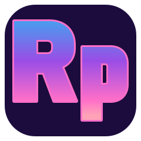
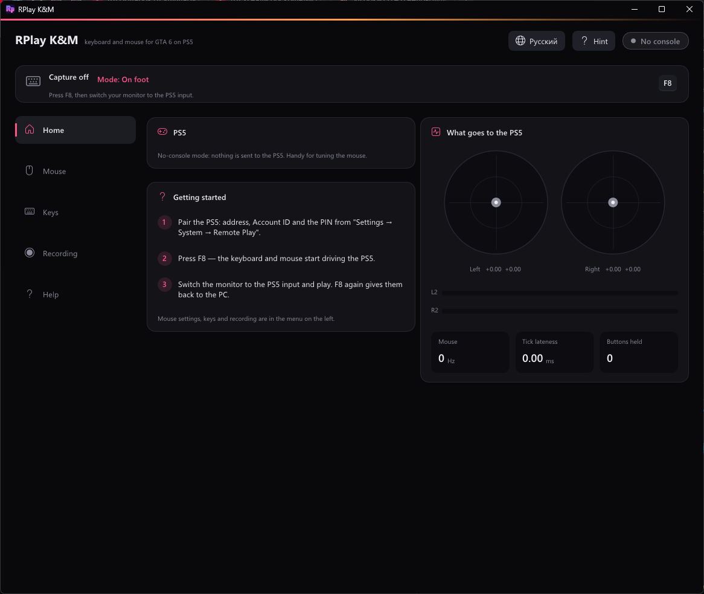
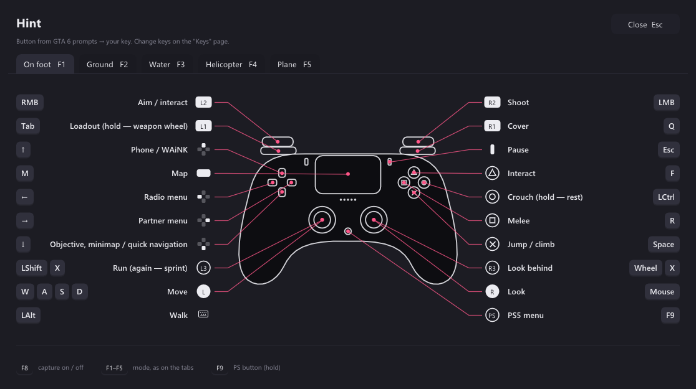
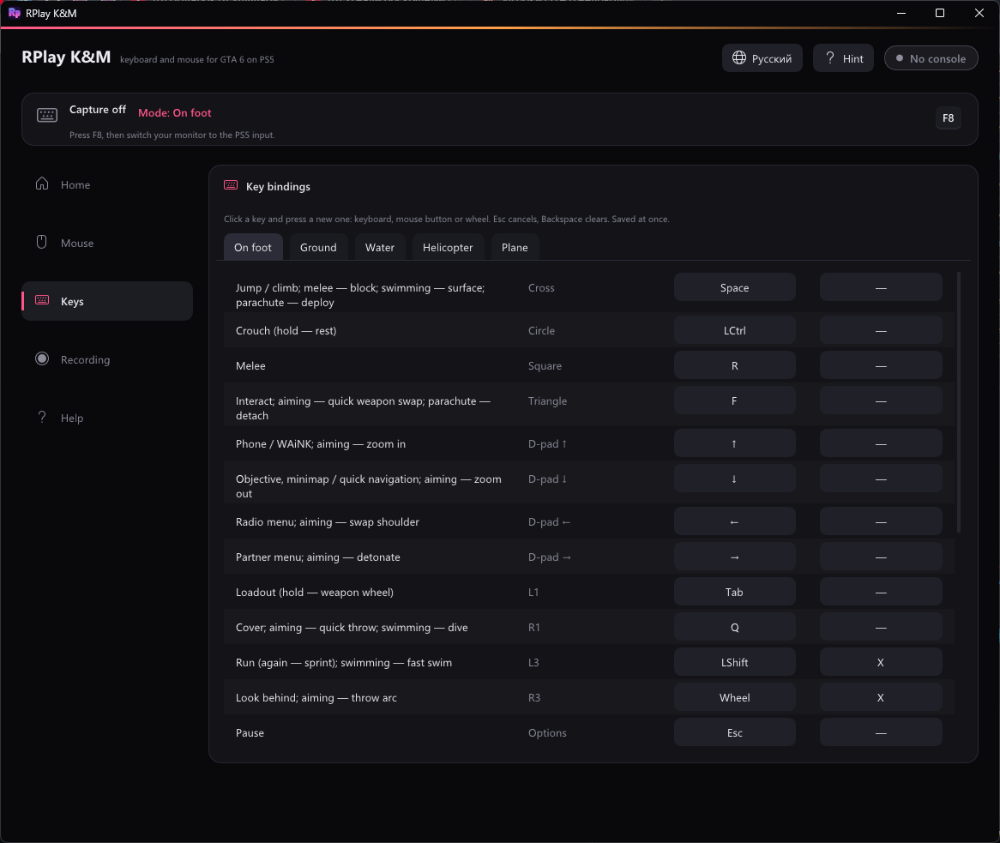

<p align="center">
  
</p>

<h1 align="center">RPlay K&amp;M</h1>

<p align="center">
  <b>Keyboard and mouse for GTA 6 on PS5.</b><br>
  No adapters or dongles — just a Windows PC on the same home network.
</p>

<p align="center">
  <a href="README.md"></a>&nbsp;&nbsp;
</p>

<p align="center">
  <a href="https://github.com/1luher/RplayPS/releases/latest"></a>
  
  <a href="LICENSE"></a>
</p>

<p align="center">
  <a href="docs/screenshots/en/main.png"></a>
  <a href="docs/screenshots/en/hint.png"></a>
  <a href="docs/screenshots/en/keys.png"></a>
  <br><sub>Click a picture to see it full size</sub>
</p>

## What it is

RPlay K&M is a Windows app that turns your keyboard and mouse into a PS5 controller. The console sees
an ordinary DualSense, and you play like on PC: WASD, the mouse moves the camera, left click shoots,
right click aims.

It is made for GTA 6 only: the bindings follow the game's own "Settings → Control Scheme" screens,
with separate layouts for on foot, cars, boats, helicopters and planes.

## Features

- **Mouse as camera** — sensitivity, curve, deadzone and axis ratio, tuned live.
- **Game modes on F1–F5:** on foot, ground vehicles, water, helicopter, plane. In the air the mouse
  controls pitch and roll.
- **Smooth steering** on A/D, **soft throttle** with Alt, **weapon wheel and menus with the mouse**.
- **Rebind any key** in one click, two keys per button.
- **Hint** — a controller picture with your keys: the game says "press △", you see what to press.
- **Game sound in your PC headphones.**
- **Account ID in one click** — through Sony's official sign-in, no third-party sites.
- **Safe:** if the window loses focus or the connection drops, every button is released and the
  character stops.
- **Sound cues** — you can't see the window while the monitor shows the PS5, so everything important
  is voiced.
- **Russian and English** interface, switched with one button.

## How it works

```
Keyboard & mouse ──► RPlay K&M on PC ──► home network ──► PS5 ──► HDMI ──► monitor
                                        (inputs only)          (game, no streaming)
```

The app connects to the PS5 over Remote Play — the same protocol as Sony's official app — but
**only sends your inputs**. The picture goes from the console to the monitor over HDMI as usual:
no streaming, no compression, no video lag. Inputs reach the PS5 over the home network in a few
milliseconds.

## Getting started

1. **Download** `RPlayKM-windows-x64.zip` from [Releases](https://github.com/1luher/RplayPS/releases/latest)
   and unzip it. No installation needed.
2. **On the PS5, turn on** "Settings → System → Remote Play".
3. **Run `rplaykm.exe`** and pair the console:
   - "Find PS5 on the network" — pick your console;
   - "Get Account ID — sign in to PSN" — sign in on Sony's page with the account you play on, then
     paste the address of the "redirect" page that opens;
   - on the PS5, with the same account: "Remote Play → Pair Device", enter the PIN and press "Pair".
4. **Play:** start GTA 6, press **F8** in the app and switch your monitor to the PS5.
   **F8** again gives the keyboard and mouse back to the PC.

You pair only once. If the PS5 asks you to "press the PS button", hold **F9**.

## Controls

The **"Hint"** button in the app shows everything on a controller picture. The default layout follows
GTA on PC. **Modes are switched by hand:** got into a car — **F2**, got out — **F1**.

<details>
<summary><b>On foot (F1)</b></summary>

| Key | Button | Action |
|---|---|---|
| W A S D | left stick | Move (Alt — walk) |
| Mouse | right stick | Look |
| LMB / RMB | R2 / L2 | Shoot / aim |
| Space | ✕ | Jump, climb |
| Shift | L3 | Run (again — sprint) |
| Ctrl | ○ | Crouch |
| R | □ | Melee |
| F | △ | Interact, enter vehicle |
| Q | R1 | Cover |
| Tab | L1 | Weapon wheel (hold) |
| Mouse wheel (click) | R3 | Look behind |
| X | L3 + R3 | Focus |
| ↑ ↓ ← → | D-pad | Phone, navigation, radio, partner |
| M / Esc / F9 | touchpad / Options / PS | Map / pause / PS button |
</details>

<details>
<summary><b>Car, motorcycle, boat (F2, F3)</b></summary>

| Key | Button | Action |
|---|---|---|
| W / S | R2 / L2 | Throttle / brake and reverse (Alt — gently) |
| A / D | left stick | Steer |
| Q / E | left stick | Motorcycle lean |
| Space | ✕ | Handbrake |
| F | △ | Exit |
| L / Ctrl | ○ | Headlights / duck |
| Shift / H | L3 | Horn, nitrous |
| LMB / RMB | R1 / L1 | Shoot / weapon |
| ← → | D-pad | Indicators (hold — vehicle menu, partner) |
</details>

<details>
<summary><b>Helicopter and plane (F4, F5)</b></summary>

| Key | Button | Action |
|---|---|---|
| Mouse | left stick | Pitch and roll |
| W / S | R2 / L2 | Throttle up / down |
| A / D | □ / ○ | Yaw left / right |
| LMB / RMB | R1 / L1 | Shoot / weapon |
| G | L3 | Landing gear |
| F | △ | Exit |
</details>

## FAQ

<details>
<summary><b>The app can't find the PS5</b></summary>

The PS5 and the PC must be on the same network, the VPN on the PC turned off, and "Remote Play"
enabled on the PS5.
</details>

<details>
<summary><b>The game ignores input or asks to "press the PS button"</b></summary>

Hold **F9**. If that doesn't help, the pairing was made for a different PS5 account. Pair again with
the account GTA 6 is running on.
</details>

<details>
<summary><b>No sound</b></summary>

While the app is connected, the PS5 sends its sound to the app instead of the TV or the DualSense
headset. Plug your headphones into the PC — the sound plays there.
</details>

<details>
<summary><b>Capture turned itself off</b></summary>

That's a safety feature: the app window lost focus (for example, Alt+Tab). Press F8 again.
</details>

<details>
<summary><b>Can I play online?</b></summary>

The app is made for single-player. Keyboard and mouse against controller players is an unfair
advantage and may break the game's rules.
</details>

---

<sub>
License <a href="LICENSE">AGPL-3.0</a>. Remote Play network core — <a href="https://github.com/streetpea/chiaki-ng">chiaki-ng</a>.
Unofficial project, not affiliated with Sony Interactive Entertainment, Rockstar Games or Take-Two Interactive.
PlayStation, PS5, DualSense and Remote Play are trademarks of Sony; GTA and Grand Theft Auto are trademarks of Take-Two.
Use at your own risk.
</sub>
