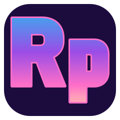
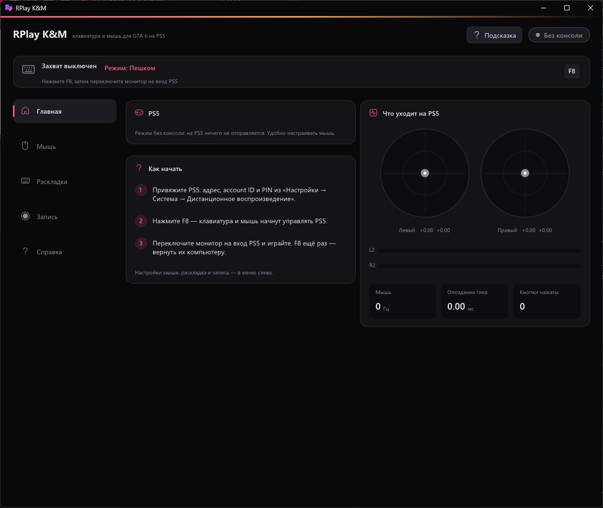
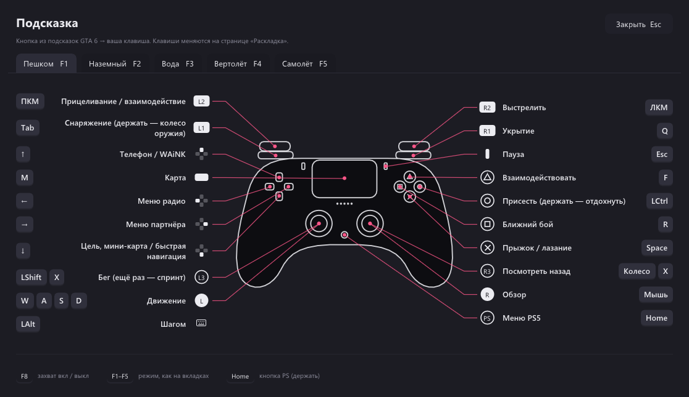
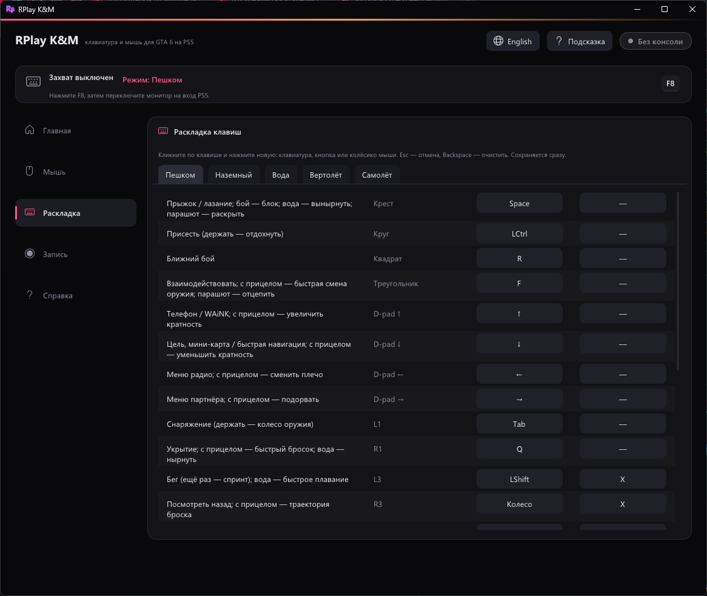

<p align="center">
  
</p>

<h1 align="center">RPlay K&amp;M</h1>

<p align="center">
  <b>Клавиатура и мышь для GTA 6 на PS5.</b><br>
  Без адаптеров и переходников — нужен только компьютер с Windows в той же домашней сети.
</p>

<p align="center">
  <a href="https://github.com/1luher/RplayPS/releases/latest"></a>
  
  <a href="LICENSE"></a>
</p>

<p align="center">
  <a href="docs/screenshots/main.png"></a>
  <a href="docs/screenshots/hint.png"></a>
  <a href="docs/screenshots/keys.png"></a>
  <br><sub>Нажмите на картинку, чтобы открыть её целиком</sub>
</p>

## Что это

RPlay K&M — программа для Windows, которая превращает клавиатуру и мышь в геймпад PS5. Консоль видит
обычный DualSense, а вы играете как на ПК: WASD, мышь крутит камеру, ЛКМ стреляет, ПКМ целится.

Сделана только под GTA 6: раскладка повторяет экраны «Настройки → Схема управления» из самой игры,
для пешком, машины, лодки, вертолёта и самолёта — своя.

## Возможности

- **Мышь как камера** — чувствительность, кривая, мёртвая зона, соотношение осей настраиваются на лету.
- **Режимы игры на F1–F5:** пешком, наземный транспорт, вода, вертолёт, самолёт. В воздухе мышь
  управляет тангажом и креном.
- **Плавный руль** на A/D, **мягкий газ** с Alt, **колесо оружия и меню мышью**.
- **Любая клавиша переназначается** в один клик, на кнопку можно повесить две клавиши.
- **Подсказка** — геймпад с вашими клавишами: игра просит «нажмите △», вы сразу видите, что жать.
- **Звук игры в наушниках на ПК.**
- **Account ID в один клик** — через официальный вход Sony, без сторонних сайтов.
- **Безопасно:** потерян фокус окна или связь — все кнопки отпускаются, персонаж останавливается.
- **Звуковые сигналы** — окна не видно, пока монитор показывает PS5, поэтому всё важное озвучено.

## Как это работает

```
Клавиатура и мышь ──► RPlay K&M на ПК ──► по домашней сети ──► PS5 ──► HDMI ──► монитор
                                         (только нажатия)          (игра без стрима)
```

Программа подключается к PS5 по протоколу Remote Play — тому же, что у официального приложения Sony, —
но **передаёт только нажатия**. Картинка идёт с консоли на монитор по HDMI напрямую, как обычно:
без стрима, сжатия и задержки видео. Нажатия по домашней сети доходят за единицы миллисекунд.

## Как начать

1. **Скачайте** `RPlayKM-windows-x64.zip` из [релизов](https://github.com/1luher/RplayPS/releases/latest)
   и распакуйте. Установка не нужна.
2. **На PS5 включите** «Настройки → Система → Дистанционное воспроизведение».
3. **Запустите `rplaykm.exe`** и привяжите консоль:
   - «Найти PS5 в сети» — выберите консоль;
   - «Узнать Account ID — войти в PSN» — войдите на странице Sony под аккаунтом, на котором играете,
     и вставьте адрес открывшейся страницы «redirect»;
   - на PS5 под этим же аккаунтом: «Дистанционное воспроизведение → Привязать устройство», введите PIN
     и нажмите «Привязать».
4. **Играйте:** запустите GTA 6, нажмите **F8** в программе и переключите монитор на PS5.
   Ещё раз **F8** — вернуть клавиатуру и мышь компьютеру.

Привязка делается один раз. Если PS5 просит «нажмите кнопку PS» — зажмите **F9**.

## Управление

Кнопка **«Подсказка»** в программе показывает всё на картинке геймпада. Раскладка по умолчанию — как в GTA
на ПК. **Режим переключается вручную:** сели в машину — **F2**, вышли — **F1**.

<details>
<summary><b>Пешком (F1)</b></summary>

| Клавиша | Кнопка | Действие |
|---|---|---|
| W A S D | левый стик | Движение (Alt — шагом) |
| Мышь | правый стик | Обзор |
| ЛКМ / ПКМ | R2 / L2 | Выстрелить / прицелиться |
| Space | ✕ | Прыжок, лазание |
| Shift | L3 | Бег (ещё раз — спринт) |
| Ctrl | ○ | Присесть |
| R | □ | Ближний бой |
| F | △ | Взаимодействовать, сесть в транспорт |
| Q | R1 | Укрытие |
| Tab | L1 | Колесо оружия (держать) |
| Колесо мыши (нажать) | R3 | Посмотреть назад |
| X | L3 + R3 | Фокус |
| ↑ ↓ ← → | D-pad | Телефон, навигация, радио, партнёр |
| M / Esc / F9 | тачпад / Options / PS | Карта / пауза / кнопка PS |
</details>

<details>
<summary><b>Машина, мотоцикл, лодка (F2, F3)</b></summary>

| Клавиша | Кнопка | Действие |
|---|---|---|
| W / S | R2 / L2 | Газ / тормоз и задний ход (Alt — мягко) |
| A / D | левый стик | Руль |
| Q / E | левый стик | Наклон мотоцикла |
| Space | ✕ | Ручной тормоз |
| F | △ | Выйти |
| L / Ctrl | ○ | Фары / пригнуться |
| Shift / H | L3 | Клаксон, нитро |
| ЛКМ / ПКМ | R1 / L1 | Стрелять / оружие |
| ← → | D-pad | Поворотники (держать — меню машины, партнёра) |
</details>

<details>
<summary><b>Вертолёт и самолёт (F4, F5)</b></summary>

| Клавиша | Кнопка | Действие |
|---|---|---|
| Мышь | левый стик | Тангаж и крен |
| W / S | R2 / L2 | Газ больше / меньше |
| A / D | □ / ○ | Курс влево / вправо |
| ЛКМ / ПКМ | R1 / L1 | Стрелять / оружие |
| G | L3 | Шасси |
| F | △ | Выйти |
</details>

## Частые вопросы

<details>
<summary><b>Программа не находит PS5</b></summary>

PS5 и компьютер должны быть в одной сети, VPN на компьютере выключен, на PS5 включено
«Дистанционное воспроизведение».
</details>

<details>
<summary><b>Игра не слушается или просит «нажмите кнопку PS»</b></summary>

Зажмите **F9**. Если не помогло — привязка сделана на другой аккаунт PS5. Привяжите заново под тем
аккаунтом, на котором запущена GTA 6.
</details>

<details>
<summary><b>Нет звука</b></summary>

Пока работает программа, PS5 отдаёт звук ей, а не телевизору и не наушникам в DualSense. Подключите
наушники к компьютеру — звук будет там.
</details>

<details>
<summary><b>Захват выключился сам</b></summary>

Это защита: окно программы потеряло фокус (например, Alt+Tab). Нажмите F8 снова.
</details>

<details>
<summary><b>Можно ли играть онлайн?</b></summary>

Программа сделана для одиночной игры. Клавиатура и мышь против игроков с геймпадами — нечестное
преимущество, и это может противоречить правилам игры.
</details>

---

<sub>
Лицензия <a href="LICENSE">AGPL-3.0</a>. Сетевое ядро Remote Play — <a href="https://github.com/streetpea/chiaki-ng">chiaki-ng</a>.
Неофициальный проект, не связан с Sony Interactive Entertainment, Rockstar Games и Take-Two Interactive.
PlayStation, PS5, DualSense и Remote Play — товарные знаки Sony; GTA и Grand Theft Auto — товарные знаки Take-Two.
Используйте на свой риск.
</sub>
