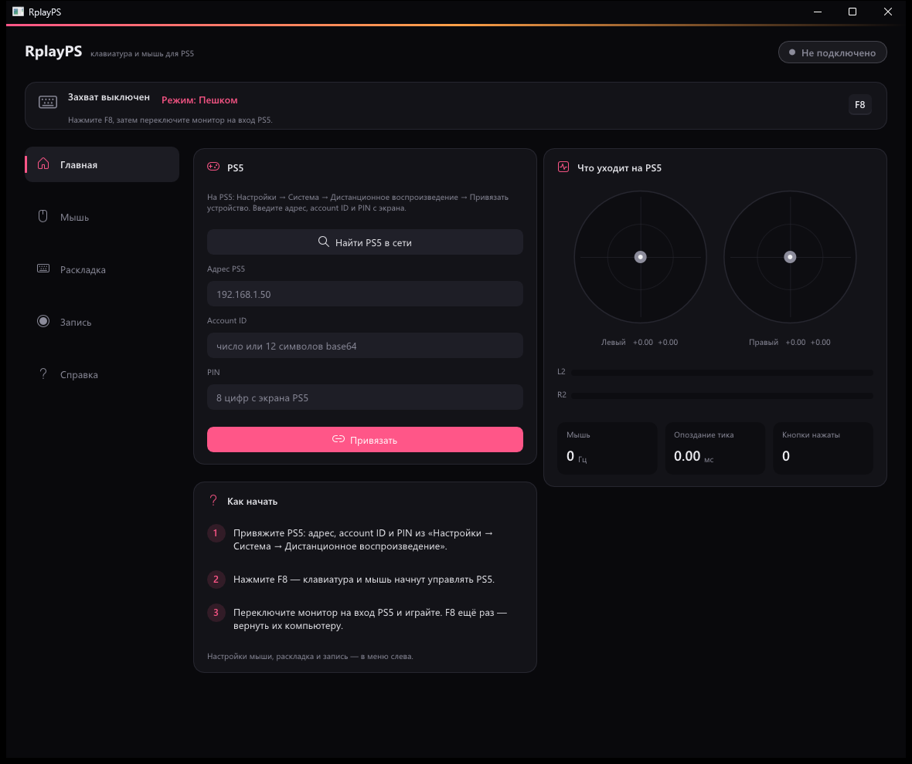

# RplayPS: клавиатура и мышь для PS5

Играть на PS5 клавиатурой и мышью в игры, которые их не поддерживают (в первую очередь
GTA 6). Нужен только компьютер с Windows в той же домашней сети.

> Статус: **первая версия (MVP)**. Программа собирается, тесты проходят, ввод проверен.
> Работа с настоящей PS5 ещё не проверена — чек-лист в [docs/notes-gta6.md](docs/notes-gta6.md).



## Сборка
Нужны Visual Studio 2022 Build Tools (C++) и CMake.

```bash
cmake -S . -B build -G "Visual Studio 17 2022" -A x64
```

```bash
cmake --build build --config Release
```

Получатся `build/Release/rplayps.exe` (программа), `rplayctl.exe` (консольная утилита),
`inputcheck.exe` (проверка ввода без PS5) и `rplay_tests.exe` (тесты).

## Как пользоваться
1. Запустите `rplayps.exe`, привяжите PS5: адрес, account ID и PIN с экрана
   **Настройки → Система → Дистанционное воспроизведение → Привязать устройство**.
2. Нажмите **F8** — включится захват клавиатуры и мыши.
3. Переключите монитор на вход PS5 и играйте. **F8** ещё раз — вернуть клавиатуру и мышь компьютеру.

## Как это будет работать

```
Клавиатура + мышь
      │  Windows Raw Input (1000 Гц)
      ▼
[RplayPS на ПК]  мышь → правый стик: кривая, калибровка, профили
      │  протокол PS Remote Play по локальной сети (только управление)
      ▼
[PS5]  думает, что подключён обычный геймпад
      │  HDMI
      ▼
[Монитор, вход HDMI от PS5]  игра идёт как обычно, без сжатия видео
```

Главная идея: Remote Play используется **только для передачи нажатий**, видео не принимаем.
Картинка идёт с PS5 на монитор напрямую, без задержки потокового видео. Добавляется только задержка
нажатий по локальной сети, это единицы миллисекунд.

## Документы
| Файл | О чём |
|---|---|
| [docs/best-of.md](docs/best-of.md) | Что берём из других проектов и почему |
| [docs/architecture.md](docs/architecture.md) | Как устроим программу: ввод, мышь → стик, калибровка, профили |
| [docs/roadmap.md](docs/roadmap.md) | План по шагам и что сделать дома |
| [docs/superpowers/plans/2026-11-20-rplayps-mvp.md](docs/superpowers/plans/2026-11-20-rplayps-mvp.md) | Подробный план первой версии (этапы 1–2) |
| [docs/research.md](docs/research.md) | Обзор готовых решений |
| [docs/keyboard-ds5.md](docs/keyboard-ds5.md) | Подробный разбор keyboard-ds5 |

## Основа
Свой код. Для связи с PS5 используем сетевое ядро [chiaki-ng](https://github.com/chiaki-ng/chiaki-ng):
его активно поддерживают и чинят после обновлений прошивки PS5. Поэтому лицензия проекта —
**AGPL-3.0**.

## Предупреждение
Это неофициальный проект, он не связан с Sony или Rockstar. Неофициальный клиент Remote Play
может нарушать правила PSN. Эмуляция геймпада с клавиатуры и мыши в онлайн-режимах может
нарушать правила игры. Цель проекта — одиночная игра.
